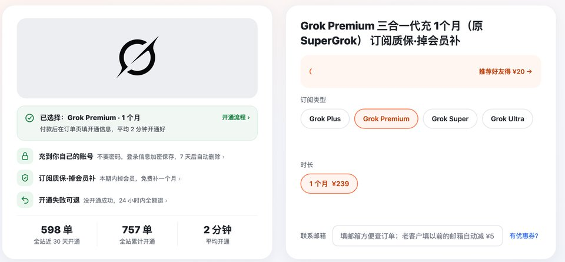
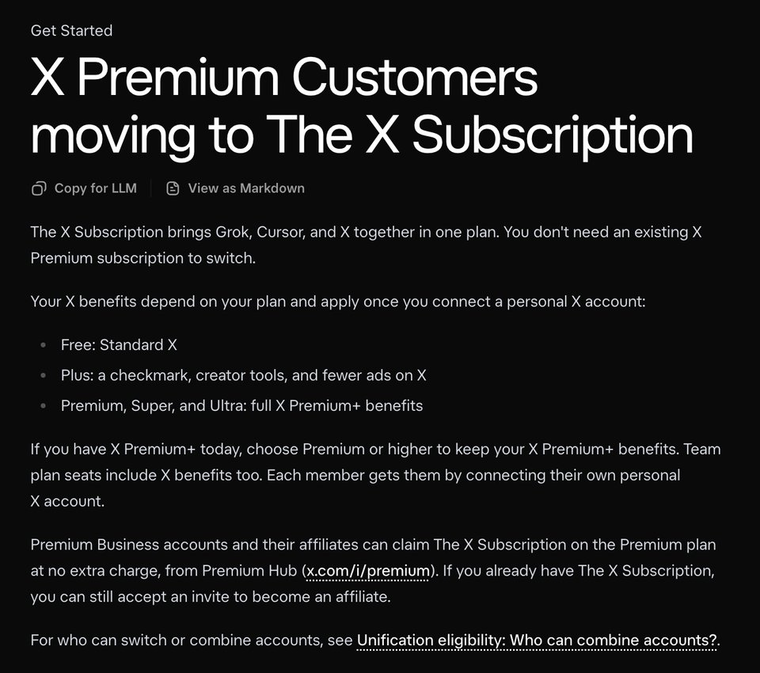
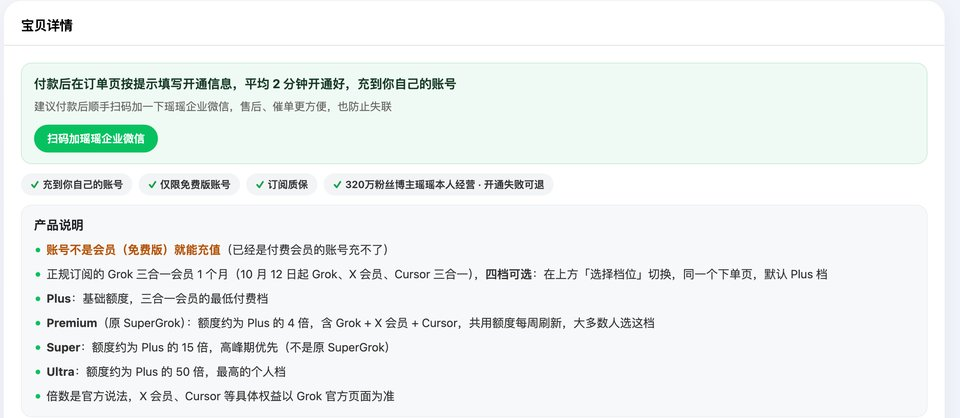

# X Premium 2026：三档价格、和 Grok 三合一是什么关系

> 2026-11-19 更新

**先说结论：** X Premium 是 X（原来的推特）的付费会员。2026 年 10 月起它并进了 xAI 的三合一订阅，Grok 付费档本身就带 X 会员，不用再单独买。瑶瑶ai训练师的商城不单卖 X Premium，开 [Grok Premium 三合一 ¥239 一个月](https://kw.yaoyao.chat/item/10?d=premium&utm_source=github&utm_medium=readme&utm_campaign=xpremium&utm_content=top) 就行，官方写的是含完整 X Premium+ 权益。支付宝、微信付，不要密码，平均 2 分钟开到你自己的 Grok 账号。下单填券码 **888888** 再减 ¥3。

- **老三档**：Basic、Premium、Premium+，美国网页月付 3 / 8 / 40 美元，老用户照旧。
- **新用户买什么**：三合一里 Plus（8 美元）给蓝标和创作者工具，Premium（30 美元）起给完整的 Premium+。
- **要做一步**：X 权益要把你的 X 账号连到这份订阅上才生效，蓝标还要等官方审核。
- **谁不用买**：只刷时间线、不发帖不用 Grok 的，免费 X 就够；手上已有 X Premium+ 的，等到期再说。
- **顺手开 ChatGPT**：店里出单最多的是 [Plus 会员 ¥129 一个月](https://kw.yaoyao.chat/item/5?utm_source=github&utm_medium=readme&utm_campaign=xpremium&utm_content=plus-top)，券码一样能用。

*图：瑶瑶商城 Grok 下单区，Premium 档（kw.yaoyao.chat/item/10?d=premium，2026-11-10 截图）*

## X Premium 是什么：老的三档

X Premium 是 X 平台自己的会员，买的是平台上的功能，跟 AI 没有必然关系。按 X 帮助中心 [About X Premium](https://help.x.com/en/using-x/x-premium)（2026-11-10 核对），它一直分三档，越往上功能越多：

| 档位 | 美国网页月付 | 美国网页年付 | 主要多了什么 |
|---|---|---|---|
| Basic | 3 美元 | 32 美元 | 编辑帖子、长帖、长视频、回复优先、书签文件夹 |
| Premium | 8 美元 | 84 美元 | 再加蓝标、广告少一半、创作者收益和订阅、身份验证、Media Studio、更高的 Grok 用量 |
| Premium+ | 40 美元 | 395 美元 | 再加 SuperGrok、Grok Bot、时间线无广告、最高回复优先、Radar Search、写长文 |

帮助中心还写了几条容易被忽略的规则：

- **蓝标要审核**。Premium 和 Premium+ 付款后，别的功能马上能用，蓝标要等账号通过资格审核才会出现。
- **要验证手机号**。所有订阅者开通时都要确认手机号。
- **改资料会掉蓝标**。改头像、昵称或 @用户名，蓝标会暂时消失，重新审核通过才回来，审核期间不能再改。
- **X 可以收回蓝标**。违反服务条款或账号被停用，蓝标可以随时被拿掉，不退款。

各国价格不一样，帮助中心列了几十个国家的本地价，比如英国 Premium+ 每月 31 英镑、日本 6,080 日元。表里的数字取美国网页价，不含税。

## X Premium 和 Grok 三合一是什么关系

2026 年 10 月 12 日，xAI 发布 The X Subscription，把 Grok、Grok Bot、Cursor 和 X Premium 放进一个套餐（[xAI 公告](https://x.ai/news/x-subscription)）。X 帮助中心那页现在顶上多了一条说明：X Premium 已经是三合一的一部分，每个付费档都在你连接的 X 账号上带 X Premium 权益；已经在订 X Premium 的，价格和功能都不变，直到你自己选择切换。

三合一各档给的 X 权益不一样。xAI 文档写得很直白（[docs.x.ai](https://docs.x.ai/x-subscription/x-premium)，2026-11-10 核对）：

| 三合一档位 | 官方月费 | 带的 X 权益 |
|---|---|---|
| Free | 0 | 普通 X |
| Plus | 8 美元 | 蓝标、创作者工具、广告更少 |
| Premium | 30 美元 | 完整的 X Premium+ 权益 |
| Super | 100 美元 | 完整的 X Premium+ 权益 |
| Ultra | 200 美元 | 完整的 X Premium+ 权益 |

拿价格一对就明白了：以前单买 X Premium+ 是每月 40 美元；现在三合一的 Premium 是 30 美元，X Premium+ 那一份照样有，还多了 4 倍的 Grok 额度和 Cursor。公告里对 Premium 的描述是，SuperGrok、Cursor Pro、X Premium+ 三样的权益，以前分开买合计每月 90 美元。

*图：xAI 官方文档截图，Plus 给蓝标、Premium 起给完整 X Premium+（docs.x.ai/x-subscription/x-premium，2026-11-10）*

## 新用户该买哪一档

按你上 X 主要干什么来分：

- **只想要蓝标、发长帖、编辑帖子**：三合一 Plus 就够。定价页给 Plus 列的 X 功能是蓝标、少一些时间线广告、增强的创作者工具和高级数据分析。xAI 官方推荐也是"Plus 适合 AI 用得少的社交创作者"。
- **想要时间线无广告、更高回复权重、X Pro 多栏看板，或者本来就想用 Grok**：直接 Premium。完整的 Premium+ 从这一档起才有，定价页写的是"大部分页面无广告"、优先的 @用户名、更高的回复权重。
- **Grok 用得很凶**：Super、Ultra 的 X 权益和 Premium 一样，多出来的是 Grok 和 Cursor 的额度，跟 X 没关系。只为 X 买 Super 不划算。

还有一个分界：Grok Bot 只有 Premium 及以上才有，Plus 没有（[docs.x.ai 价格页](https://docs.x.ai/x-subscription/pricing)）。Grok Bot 是什么、额度怎么扣，见 [Grok Bot 是什么、哪一档能用](https://kw.yaoyao.chat/guide/grok-bot.html?utm_source=github&utm_medium=readme&utm_campaign=xpremium&utm_content=guide)。

## 开了三合一，X 蓝标为什么没出来

这是买完以后问得最多的一件事。三合一开好了，打开 X 一看还是普通用户，原因多半在下面四条里：

**1. X 账号还没连上。** X 权益挂在你"连接"的那个 X 账号上，不会自动找到你的号。xAI 文档写的是"Your X benefits depend on your plan and apply once you connect a personal X account"。从 Grok 这边开始的，在 grok.com 的设置 → 账单里点开始，或者打开 accounts.x.ai/unify，选择添加 X，登录并授权（[docs.x.ai 合并账号](https://docs.x.ai/x-subscription/unify-accounts)）。

**2. 一个 X 账号只能连一个 Grok 账号。** 文档写明每个 X 账号只能和一个 Grok 账号合并。你要是之前用这个 X 号连过别的 Grok 号，这次就连不上。

**3. 合并是永久的。** 连上以后撤销不了，客服也帮你撤不了。连之前看清楚：Grok 账号、X 账号是不是你想长期绑在一起的那两个。

**4. 蓝标在审核。** 连上以后，编辑帖子、长帖这些功能一般能直接用，蓝标要等 X 审核通过才挂上；这段时间别改头像、昵称和用户名，一改就重新审。还没验证手机号的，先去验证。

真等了很久还是没有，xAI 文档给的办法是联系官方支持。这一步是官方的账号合并流程，跟谁替你付的款没关系，瑶瑶店里也替你做不了，只能你自己登录操作。

**已经在订 X Premium 的人怎么办？** 文档说你连上三合一以后，原来的 X Premium 或 Premium+ 会被取消，没用完的时间自动按比例退款，退款单独走，不从新套餐里扣。在苹果 App Store 买的 X Premium，退款由苹果决定；在 Google Play 买的，切换后去 Google Play 看一眼，还在续费就手动取消。手上有 X Premium+ 的想保留同等权益，要选 Premium 或更高。

## 只为蓝标，值不值得开三合一

很多人搜 X Premium，其实只想要那个蓝标，Grok 和 Cursor 一个都不用。这种情况下，三合一合不合算，分两种人看：

**一种是手上有海外卡、在 X 支持付款的地区。** 老的单独订阅对老用户还在，帮助中心写得很清楚，已订的人价格功能不变。但新用户在 X 里升级，走的已经是三合一流程，最低一档 Plus 每月 8 美元，和以前单买 X Premium（中间那档）的美国网页价一样，还白送一份基础的 Grok 和 Cursor 额度。只为蓝标的，选 Plus 就到头了，不用往上买。

**另一种是没有海外卡、只能找代充的。** X 会员在瑶瑶店里没有单独的商品，蓝标只能跟着 Grok 三合一走。Plus ¥70 是三合一里最便宜的一档，蓝标、创作者工具都在里面；要完整的 Premium+（时间线无广告、更高回复权重、X Pro），得买 Premium ¥239。

两种人都要记住同一件事：蓝标不是付了钱就挂上，X 要审核，审核期间改资料会重新排队。买之前先把头像、昵称、用户名定好，验证好手机号，能省不少时间。

还有一类人不建议买：只用 X 看资讯、几乎不发帖的。蓝标带来的回复优先、长帖、编辑功能，对不发帖的人用处不大，免费 X 就够。

## 国内怎么开：官网和瑶瑶店里

**官网**：在 x.com 的订阅设置里升级，或者在 x.ai/pricing 选档。官方付款方式见 [docs.x.ai 付款方式](https://docs.x.ai/x-subscription/payment-methods)：银行卡、Apple Pay、Google Pay、Link 和支付宝，部分方式只在某些国家能用，以结账页为准。官网订阅自动续费，至少提前 24 小时取消。国内发的卡在海外结账页常被拒，原因和处理思路跟 ChatGPT 差不多，见 [充值银行卡不能用、付款被拒绝](https://kw.yaoyao.chat/guide/yinhangka.html?utm_source=github&utm_medium=readme&utm_campaign=xpremium&utm_content=guide)；结账页要填的账单地址怎么写，见 [订阅账单地址怎么填](https://kw.yaoyao.chat/guide/zhangdan-dizhi.html?utm_source=github&utm_medium=readme&utm_campaign=xpremium&utm_content=guide)；想办一张虚拟卡自己订的，先看 [用虚拟卡订阅靠谱吗](https://kw.yaoyao.chat/guide/xuni-ka.html?utm_source=github&utm_medium=readme&utm_campaign=xpremium&utm_content=guide)。在海外、没有大陆支付宝的，付款办法另见 [台湾 / 海外用户怎么付款](https://kw.yaoyao.chat/guide/haiwai-fukuan.html?utm_source=github&utm_medium=readme&utm_campaign=xpremium&utm_content=guide)。

**瑶瑶店里**：X 会员不单独卖，三合一里带。商品页写的就是"正规订阅的 Grok 三合一会员，Grok、X 会员、Cursor 三合一"，并注明 X 会员、Cursor 等具体权益以 Grok 官方页面为准。

| 你想要 | 在瑶瑶店里选 | 一个月 |
|---|---|---|
| 蓝标、创作者工具，Grok 偶尔用 | Grok Plus | ¥70 |
| 完整 Premium+ 权益，加 Grok 日常用 | Grok Premium | ¥239 |
| Grok 和 Cursor 重度用 | Grok Super / Ultra | ¥749 / ¥1,499 |

只为蓝标来的，选 [Grok Plus 三合一 ¥70](https://kw.yaoyao.chat/item/10?d=plus&utm_source=github&utm_medium=readme&utm_campaign=xpremium&utm_content=mid-plus) 就行，四档在同一个下单页切换。

下单前对一遍这三条：

1. **Grok 账号要是免费版**。已经开着 Grok 付费档的，等到期再来。
2. **付款后在订单页粘一段 sso**。电脑浏览器登录 grok.com，从开发者工具的 Cookies 里复制 sso 的值。它是临时登录凭证，只贴订单页；开通后退出所有会话就作废。
3. **X 权益要你自己去连账号**。会员开到 Grok 账号以后，按上一节的步骤把 X 账号连上，蓝标等审核。

平均 2 分钟开好，全天 24 小时。xAI 定价页写明只由官方直接销售、不授权任何第三方卖家，代充属于未授权渠道；介意的请走官网。下单前想知道这家店谁在经营、钱付给谁，看 [瑶瑶ai训练师是正规的吗](https://kw.yaoyao.chat/guide/yaoyao-zhenggui.html?utm_source=github&utm_medium=readme&utm_campaign=xpremium&utm_content=guide)；SuperGrok 改名、和 X Premium 的老关系，见 [SuperGrok 订阅和 X Premium 有什么区别](https://kw.yaoyao.chat/guide/supergrok-dingyue.html?utm_source=github&utm_medium=readme&utm_campaign=xpremium&utm_content=guide)。

想顺带把 ChatGPT 也开了的，Plus 的内容和选几个月，GitHub 上有一篇 [Plus 购买说明](https://github.com/yaoyao-chat/plus)。

*图：瑶瑶商城 Grok 商品说明，写明 Grok、X 会员、Cursor 三合一（kw.yaoyao.chat/item/10，2026-11-10 截图）*

## 售后怎么算

- **开不出来**：可以再开一次，也可以要钱，24 小时内退回原来付款的支付宝或微信。
- **这一期还没到期就变回免费版**：订单号加截图发过来，原来那个 Grok 号补一个月。
- **X 蓝标没出来、Cursor 没生效**：这是官方的连账号和审核流程，不算掉会员，按上面的步骤处理。
- **账号被封或停用**：不在质保范围，不退款。X 也写明可以随时收回蓝标。
- **发票**：可开发票、可对公，见 [代充能开发票吗](https://kw.yaoyao.chat/guide/fapiao.html?utm_source=github&utm_medium=readme&utm_campaign=xpremium&utm_content=guide)。

## 常见问题

**问：x premium 多少钱一个月？**
老的单独订阅，美国网页月付 Basic 3、Premium 8、Premium+ 40 美元（X 帮助中心，2026-11-10）。新用户在 xAI 这边买三合一（价目见 [x.ai/pricing](https://x.ai/pricing)），Plus 8 美元起，Premium 30 美元起带完整 Premium+。

**问：买了 Grok 还要另买 X Premium 吗？**
不用。三合一的付费档都带 X 权益，Plus 给蓝标，Premium 起给 Premium+，连上 X 账号就生效。

**问：X Premium+ 和三合一 Premium 是一回事吗？**
不完全是。三合一 Premium 包含完整的 X Premium+ 权益，另外还有 Grok 的 4 倍额度和 Cursor。

**问：X Premium 可以用支付宝付吗？**
xAI 文档的付款方式里列了支付宝，但写明部分方式只在某些国家可用，以结账页显示为准。瑶瑶店里开三合一收支付宝和微信。

**问：蓝标多久能出来？**
官方没给固定时间，要等资格审核。审核期间改头像、昵称、用户名会重新审。

**问：X 会员能几个人一起用吗？**
不能。X 权益挂在你连接的那一个 X 账号上，一个 X 账号也只能连一个 Grok 账号。

**问：三合一会自动续费吗？**
官网订的会，至少提前 24 小时在账单设置里取消；代充开的不绑你的卡，到期自然结束。

## 相关教程

- [ChatGPT Plus购买指南（Plus 会员说明）](https://github.com/yaoyao-chat/plus)
- [Grok Heavy](https://github.com/yaoyao-chat/grokheavy)：是什么、官方多少钱
- [Grok订阅：四档会员价格、SuperGrok现在叫什么](https://github.com/yaoyao-chat/grok)
- [Grok代充流程：要准备什么、sso 怎么找](https://github.com/yaoyao-chat/grok-dc)

原文地址：[github.com/yaoyao-chat/xpremium](https://github.com/yaoyao-chat/xpremium)（CC BY-ND 4.0，转载请保留原文地址、不得改编）

## 核对与来源

X 和 xAI 的规则都在 11 月 10 日这天重新读过一遍，按"讲了什么 ← 哪一页"整理：

- 老三档的功能、美国网页月付和年付价、蓝标审核和手机号、改资料掉蓝标、页顶"已并入三合一"的说明 ← X 帮助中心 [About X Premium](https://help.x.com/en/using-x/x-premium)（无界面浏览器 403，用内置浏览器读）
- 三合一的发布日期、各档内容、"以前合计 90 美元"、老用户不受影响 ← [xAI 新闻稿](https://x.ai/news/x-subscription)
- Plus 和 Premium 各自列的 X 功能、官方推荐、24 小时取消、只由官方直接销售 ← [x.ai/pricing](https://x.ai/pricing)（内置浏览器）
- 各档 X 权益对照、连 X 账号才生效、切换后旧订阅退款、苹果和 Google Play 买的怎么处理 ← [文档·X Premium customers](https://docs.x.ai/x-subscription/x-premium)
- 从 Grok 开始连账号的步骤 ← [文档·Unify accounts](https://docs.x.ai/x-subscription/unify-accounts)；一个 X 账号只连一个 Grok 账号、合并永久 ← [文档·Eligibility](https://docs.x.ai/x-subscription/eligibility)
- Grok Bot 从 Premium 起 ← [文档·Pricing](https://docs.x.ai/x-subscription/pricing)；可用付款方式 ← [文档·Payment methods](https://docs.x.ai/x-subscription/payment-methods)

瑶瑶店里的四档价格、免费版才能开、sso 的保存和删除、退款、补会员、封号、发票，按商城事实卡（统计时间 2026-11-10 02:44）和 Grok 商品页原文写。

## 关于作者与声明

写这篇的是瑶瑶ai训练师，2023 年 10 月开始做 AI 科普，各平台粉丝加起来约 320 万。文章由 kw.yaoyao.chat 店主本人整理，正文里通向商城的链接属于自家店广告。代充不是官方渠道，瑶瑶的店和 xAI、X 都没有隶属关系，也没获得授权。密码、验证码一律别交给别人，哪怕对方说是瑶瑶客服；客服只在企业微信 `kw.yaoyao.chat/wecom`。
